<p align="center">
  
</p>

<p>
  <a href="https://nextjs.org"><picture><source media="(prefers-color-scheme: dark)" srcset="docs/images/readme/badge-next-dark.svg"></picture></a>
  <a href="https://convex.dev"><picture><source media="(prefers-color-scheme: dark)" srcset="docs/images/readme/badge-convex-dark.svg"></picture></a>
  <a href="https://openrouter.ai"><picture><source media="(prefers-color-scheme: dark)" srcset="docs/images/readme/badge-openrouter-dark.svg"></picture></a>
  <a href="LICENSE"><picture><source media="(prefers-color-scheme: dark)" srcset="docs/images/readme/badge-license-dark.svg"></picture></a>
  <a href="https://eagledev.in/blog/why-i-built-mission-control"><picture><source media="(prefers-color-scheme: dark)" srcset="docs/images/readme/badge-writeup-dark.svg"></picture></a>
</p>

Mission Control is a multi-agent research app. You type a goal, an orchestrator splits it into tasks, a small team of AI agents works on them in parallel, and you watch every step on a live graph. At the end you get a markdown report with every source linked.

I built it because deep research in Claude and ChatGPT is good but slow, and while it runs you only get a status line and a timer. Here the work is the interface. Click any task to see what the agent thought, which pages it read, and how many tokens it spent. If one part comes back wrong, fix that part from the chat and keep the rest. It all runs on free models.

## Features

- **Live mission graph.** Tasks run in waves, and every edge shows its state: waiting, carrying work, or delivered.
- **A trace for every agent.** Thoughts, searches, pages read, model, time, and tokens.
- **Cited reports.** Each source is listed once and numbered. Every edit makes a new version, and the old ones stay.
- **Follow-ups in the chat.** Ask questions, rerun or add a task, rewrite the report, or save it to an app.
- **Your own apps.** The Librarian searches 17 apps through [Composio](https://composio.dev). Write access is off until you turn it on, and even then it only creates new items.
- **Durable runs.** Missions run on the server, so closing the tab does not stop them.
- **Simulated mode.** Try the whole app with no API keys.

## How it works

<p align="center"></p>

| Agent | What it does | Tools |
|---|---|---|
| Orchestrator | Splits the goal into 2 to 6 tasks and sets their order, then handles follow-ups. | none |
| Researcher | Searches the web, reads the best pages, and writes up what it found. | `web_search` `fetch_url` `write_section` |
| Librarian | Searches your connected apps, and creates items where you allow it. | `app_search` `app_write` `write_section` |
| Writer | Turns the research into a comparison, a table, or a recommendation. | `write_section` |
| Assembler | Merges the parts into one report and lists every source once. | none |

- The engine is a Convex workflow: plan, then waves of tasks, then the assembler. Each step writes events to one append-only log.
- The browser subscribes to that log, and one pure reducer turns it into the graph, the stream, and the trace. The landing demo replays a recorded log through the same reducer.
- A shared rate limiter guards every model and tool call. A mission gets 60 model calls, each follow-up adds 40, and a cron fails any mission that has been idle for 10 minutes.

## Built for free models

<p align="center"></p>

The free OpenRouter tier allows 20 requests a minute and 1,000 a day across all users, which is about 25 to 40 missions. Each user gets 3 a day. To make that work:

- Each agent has a chain of free models. A provider error, a broken tool call, or bad output passes the call to the next model.
- `web_search` tries Linkup, then Exa, then Tavily. All three have free plans that need no card.
- `fetch_url` reads pages through Jina Reader, with a guarded direct fetch as the backup. BM25 picks the best 8,000 characters, so it uses no model calls.
- When fewer than 45 calls are left for the day, new missions wait. Running ones finish.

## Tech stack

<picture><source media="(prefers-color-scheme: dark)" srcset="docs/images/readme/strip-built-dark.svg"></picture>

| Part | Choice |
|---|---|
| Web | Next.js 16 (App Router), React, TypeScript, shadcn/ui on Base UI, Tailwind, Motion |
| Graph | React Flow with a dagre layout |
| Backend | Convex: database, reactive queries, Workflow and Rate Limiter components |
| Auth | Better Auth on Convex: email and password, GitHub, Google |
| AI | Free OpenRouter models through the Vercel AI SDK |
| Tools | Linkup, Exa, and Tavily for search, Jina Reader for pages, Composio for apps |

There is no LangChain. The AI SDK already handles multi-step tool calls and structured output.

## Getting started

```bash
npm install
npx convex dev                     # in its own terminal; the first run writes .env.local
npx convex env set NAME value      # see Environment variables
echo "NEXT_PUBLIC_SITE_URL=http://localhost:3000" >> .env.local
npm run dev                        # open http://localhost:3000
```

Without an OpenRouter key, missions run in simulated mode: scripted agents with realistic delays and no model or search calls. To deploy on Vercel and Convex Cloud, follow [`docs/deploy.md`](docs/deploy.md).

## Environment variables

Set these on Convex with `npx convex env set`. Only the first two are required.

<details>
<summary>Show all variables</summary>

| Name | Purpose |
|---|---|
| `BETTER_AUTH_SECRET` | Session signing. 32 random bytes in base64. |
| `SITE_URL` | The web app URL, for example `http://localhost:3000`. |
| `GITHUB_CLIENT_ID`, `GITHUB_CLIENT_SECRET` | GitHub sign-in. Callback: `{SITE_URL}/api/auth/callback/github`. |
| `GOOGLE_CLIENT_ID`, `GOOGLE_CLIENT_SECRET` | Google sign-in. Callback: `{SITE_URL}/api/auth/callback/google`. |
| `OPENROUTER_API_KEY` | Live model calls. |
| `OPENROUTER_DAILY_CAP` | The account's daily request cap. Default 1000. |
| `OPENROUTER_MODELS` | One model chain for every agent, comma-separated. Replaces the presets in `src/shared/models.ts`. |
| `OPENROUTER_MODELS_<AGENT>` | A chain for one agent: `ORCHESTRATOR`, `RESEARCHER`, `WRITER`, `LIBRARIAN`, or `ASSEMBLER`. |
| `LINKUP_API_KEY`, `EXA_API_KEY`, `TAVILY_API_KEY` | `web_search`, tried in that order. Without any, agents use `fetch_url` only. |
| `LINKUP_DAILY_CAP`, `EXA_DAILY_CAP`, `TAVILY_DAILY_CAP` | Searches a day per service. Defaults 130, 25, and 30. |
| `JINA_API_KEY` | Higher Jina Reader limits. |
| `LLM_MODE` | `simulated` or `live`. Default: live when an OpenRouter key is set. |
| `MISSION_QUOTA` | Missions per user per day. Default 3. `off` removes the limit. |
| `COMPOSIO_API_KEY` | Connect apps on the Integrations page. |

A sign-in button shows only when its provider has keys. Next.js reads `NEXT_PUBLIC_CONVEX_URL`, `NEXT_PUBLIC_CONVEX_SITE_URL`, and `NEXT_PUBLIC_SITE_URL` from `.env.local`.

</details>

## Scripts

| Command | Does |
|---|---|
| `npm run dev` | Web app in development |
| `npx convex dev` | Convex functions, with codegen on save |
| `npm test` | Backend tests |
| `npm run build` | Production build |
| `npm run lint` | ESLint |

## Project structure

```
convex/              schema, missions, events, quotas, auth, integrations
convex/engine/       the mission engine: workflow, plan, worker, assembler, tools
src/shared/          events, reducer, plan rules, model chains, constants
src/features/        the UI, one folder per feature
fixtures/missions/   recorded event logs for the landing demo
docs/                product spec, tech spec, deploy guide
```

Every tunable number (limits, timeouts, budgets) is in [`src/shared/constants.ts`](src/shared/constants.ts).

## Roadmap

v2 is specced in [`docs/prd.md`](docs/prd.md): a critic that reviews each task, approval gates, replay, share links, scheduled missions, and PDF export.

## License

MIT. See [`LICENSE`](LICENSE). Made by [eagledev.in](https://eagledev.in).
